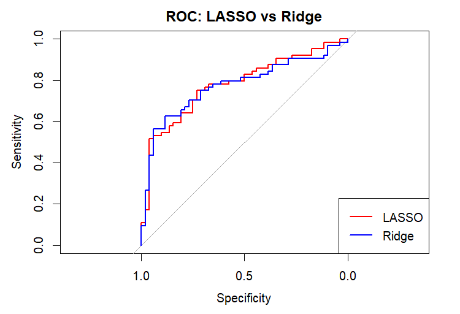
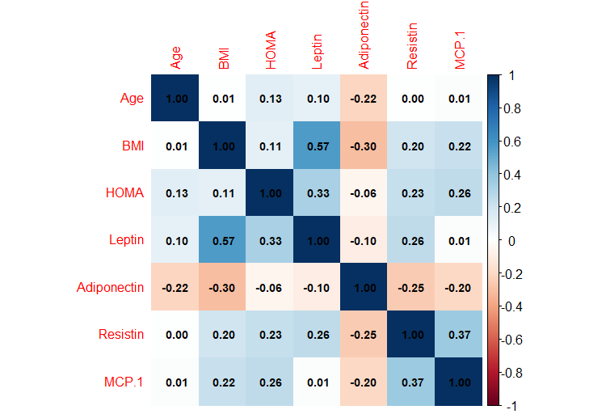
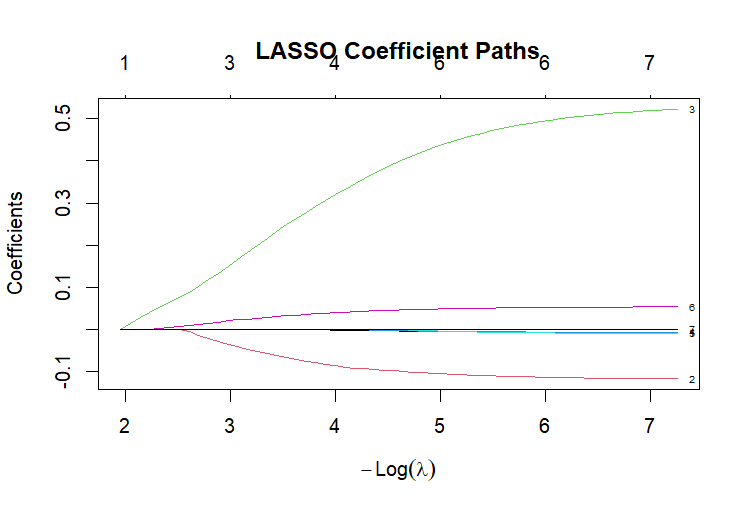

# Biomarkers Associated with Breast Cancer Status: A Penalized Logistic Regression Approach

Identifying clinical biomarkers associated with breast cancer status using LASSO and ridge logistic regression, with penalties chosen by 10-fold cross-validation and performance assessed by ROC curves and AUC.

**Course project, STAT 6040, Western Michigan University (2026)**

📄 [Full report (PDF)](report/breast_cancer_penalized_regression_report.pdf) · 💻 [R code](code/breast_cancer_analysis.R)

---

## Problem

Metabolic, hormonal, and inflammatory biomarkers have been studied for their association with breast cancer. This project asks:

1. Which biomarkers are associated with breast cancer status?
2. How well do LASSO and ridge logistic regression models discriminate between women with and without breast cancer?

## Data

- Case-control dataset of **116 women** (Breast Cancer Coimbra Dataset, UCI Machine Learning Repository)
- Outcome: breast cancer status (Yes / No)
- Predictors: Age, BMI, HOMA (insulin resistance), Leptin, Adiponectin, Resistin, and MCP-1

> The dataset is not included in this repository. Only the analysis code, figures, and report are shared.

## Methods

- **Exploratory analysis:** summary statistics and a correlation matrix of the seven biomarkers
- **LASSO logistic regression (L1 penalty):** shrinks some coefficients exactly to zero, performing variable selection
- **Ridge logistic regression (L2 penalty):** shrinks all coefficients toward zero while retaining every predictor
- **Tuning:** penalty λ chosen by 10-fold cross-validation for each model
- **Performance:** ROC curves, AUC, and classification accuracy at a 0.5 probability cutoff

## Key Findings

- **LASSO retained BMI, HOMA, and Resistin** and shrank Age, Leptin, Adiponectin, and MCP-1 to zero.
- Higher **HOMA** (OR = 1.28) and **Resistin** (OR = 1.03) were associated with higher odds of breast cancer; **BMI** had OR = 0.94.
- Both models showed **similar, moderate discrimination**: LASSO AUC = 0.780 (accuracy 72.4%), ridge AUC = 0.774 (accuracy 70.7%).
- LASSO gave the more interpretable model, with similar predictive performance.

Final LASSO model:

```
logit(Pr(BC = Yes)) = 1.0236 − 0.0669·BMI + 0.2479·HOMA + 0.0327·Resistin
```



<details>
<summary>More figures</summary>

**Correlation matrix of biomarkers**


**LASSO coefficient paths**


</details>

## Limitations

- This is a case-control dataset, so results reflect associations rather than causal effects or population risk.
- With 116 observations, performance was assessed on the same data used to fit the models, so AUC and accuracy may be optimistic.
- LASSO can select one predictor from a group of correlated predictors somewhat arbitrarily, so the selected set may vary across samples.

## Repository Structure

```
├── README.md
├── code/
│   └── breast_cancer_analysis.R
├── report/
│   └── breast_cancer_penalized_regression_report.pdf
└── figures/
    ├── 01_correlation_matrix.png
    ├── 02_lasso_coefficient_paths.png
    └── 03_roc_lasso_vs_ridge.png
```

## How to Run

1. Place the dataset `breast-cancer.csv` (not included) in the `code/` folder, next to the script.
2. Set `code/` as the working directory (in RStudio: Session → Set Working Directory → To Source File Location), then run `breast_cancer_analysis.R`.
3. The script prints model results and saves figures (including the ridge coefficient paths) to a `figures/` folder inside `code/`.

## Tools

R: `glmnet` (LASSO, ridge), `pROC` (ROC, AUC), `corrplot`
